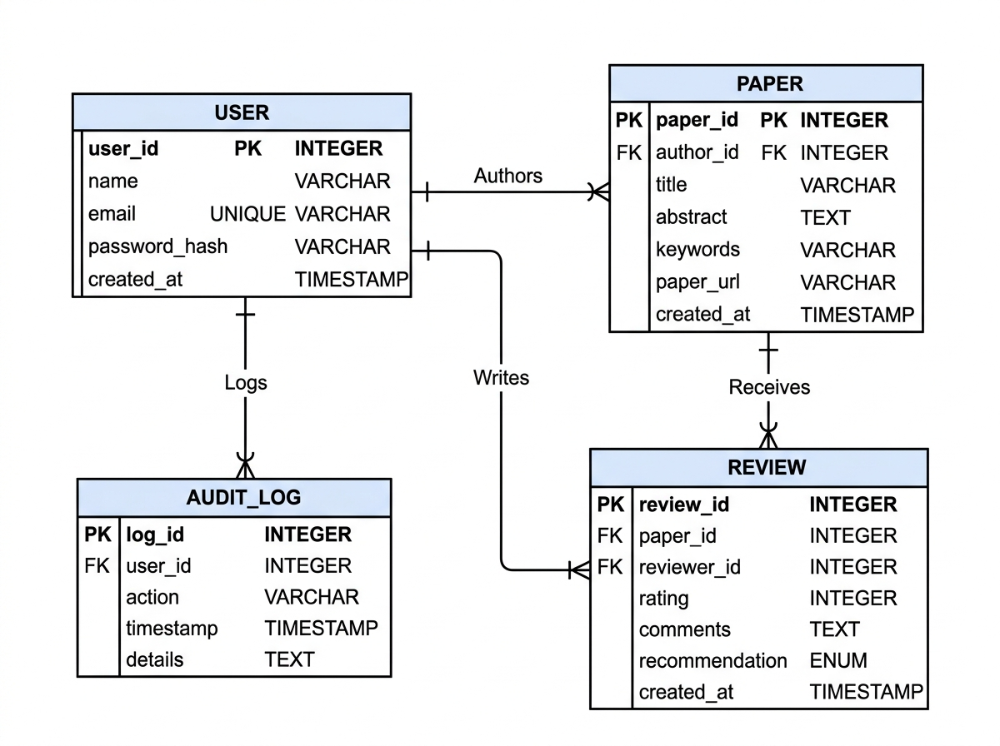

# PROE — Comprehensive DBMS Architecture & Evaluation Report

**Project Name:** Peer Review Orchestration Engine (PROE)  
**Document Type:** Formal DBMS Evaluation & Normalization Report  
**Author:** Person 3 (Database Architect & DBMS Specialist)  
**Target RDBMS:** MySQL 8.0+ (InnoDB Storage Engine)  
**Target NoSQL:** MongoDB 6.0+ (Atlas & Local)  

---

## 1. Introduction & Executive Summary

The **Peer Review Orchestration Engine (PROE)** is designed to manage the academic paper submission and peer evaluation lifecycle. This report presents the theoretical and practical database engineering foundation of the system, fulfilling all requirements of the DBMS evaluation rubric:
1. Conceptual Entity-Relationship (ER) and Enhanced ER (EER) modeling.
2. Formal Functional Dependency (FD) identification.
3. Anomaly analysis on an unnormalized database design.
4. Step-by-step relational normalization through 1NF, 2NF, 3NF, and BCNF.
5. Referential integrity definitions and physical storage considerations.

---

## 2. Conceptual & Enhanced Entity-Relationship (EER) Modeling

### 2.1 Core Entities & Attributes
- **`USER`**: `user_id` (PK), `name`, `email` (Unique), `password_hash`, `created_at`
- **`PAPER`**: `paper_id` (PK), `author_id` (FK), `title`, `abstract`, `keywords`, `paper_url`, `created_at`
- **`REVIEW`**: `review_id` (PK), `paper_id` (FK), `reviewer_id` (FK), `rating`, `comments`, `recommendation`, `created_at`
- **`AUDIT_LOG`**: `log_id` (PK), `table_name`, `action_type`, `record_id`, `description`, `created_at`

### 2.2 Enhanced ER (EER) Concepts: Role Specialization
In academic workflows, a `USER` acts in specialized roles:
- **`Author` Subclass:** Submits manuscripts (`PAPER`). An author has attributes inherited from `USER`, plus relationships to authored papers.
- **`Reviewer` Subclass:** Evaluates manuscripts (`REVIEW`). Inherits from `USER`, plus relationships to submitted reviews.

```text
               +-----------------------------+
               |            USER             |
               | (user_id, name, email, etc.)|
               +-----------------------------+
                              |
                              | (Specialization: Overlapping [O])
                     +--------+--------+
                     |                 |
                     v                 v
               +-----------+     +------------+
               |  AUTHOR   |     |  REVIEWER  |
               +-----------+     +------------+
                     |                 |
              authors (1:N)      evaluates (1:N)
                     |                 |
                     v                 v
               +-----------+     +------------+
               |   PAPER   |<----+   REVIEW   |
               +-----------+ (1:N)+------------+
```

- **Disjointness / Overlap Constraint:** **Overlapping ($O$)**. A registered academic can simultaneously author their own papers and act as a peer reviewer for manuscripts submitted by peers.
- **Completeness Constraint:** **Partial Participation**. A newly registered user may initially be neither an author nor an active reviewer until they submit or review a paper.
- **Business Rule:** An author cannot review their own paper ($\text{author\_id} \neq \text{reviewer\_id}$).

### 2.3 ER Diagram Artifact
The finalized high-resolution schema diagram is embedded below:



---

## 3. Anomaly Analysis of an Unnormalized Design (UNF)

To demonstrate the critical necessity of database normalization, consider an intentionally unnormalized, flat spreadsheet-style table `UNNORMALIZED_SUBMISSIONS`:

```text
UNNORMALIZED_SUBMISSIONS (
    user_id, user_name, user_email, user_password,
    paper_id, paper_title, paper_abstract, paper_keywords, paper_url,
    review_id, reviewer_id, reviewer_name, reviewer_email, rating, comments, recommendation
)
```

### 3.1 Insertion Anomaly
- **Problem:** If a new researcher registers on the portal but has not yet submitted a paper or written a review, their user record **cannot be inserted** into `UNNORMALIZED_SUBMISSIONS` without inserting `NULL` for `paper_id`, `review_id`, and reviewer details. If `paper_id` is part of the primary key, the entity integrity rule is violated.

### 3.2 Deletion Anomaly
- **Problem:** If a paper is retracted or deleted by an administrator, removing the record deletes the paper information, but also **accidentally deletes the author's user profile** and all historical reviewer information if that was their only submission.

### 3.3 Update (Modification) Anomaly
- **Problem:** If a user updates their email address or name, this change must be manually executed across every single row in which they appear as an author or reviewer. If any single row is missed, data becomes inconsistent across the database.

---

## 4. Formal Functional Dependencies (FDs)

Let the universe of attributes be:
$$\mathcal{U} = \{ \text{user\_id}, \text{name}, \text{email}, \text{password\_hash}, \text{paper\_id}, \text{author\_id}, \text{title}, \text{abstract}, \text{keywords}, \text{paper\_url}, \text{review\_id}, \text{reviewer\_id}, \text{rating}, \text{comments}, \text{recommendation}, \text{created\_at} \}$$

### 4.1 Functional Dependencies for User Data
1. $FD_1: \text{user\_id} \to \{ \text{name}, \text{email}, \text{password\_hash}, \text{created\_at} \}$
2. $FD_2: \text{email} \to \{ \text{user\_id}, \text{name}, \text{password\_hash}, \text{created\_at} \}$
   - **Candidate Keys for User:** $\{\text{user\_id}\}$, $\{\text{email}\}$

### 4.2 Functional Dependencies for Paper Data
3. $FD_3: \text{paper\_id} \to \{ \text{author\_id}, \text{title}, \text{abstract}, \text{keywords}, \text{paper\_url}, \text{created\_at} \}$
   - **Candidate Key for Paper:** $\{\text{paper\_id}\}$
   - **Foreign Key:** $\text{author\_id} \to \text{USERS}(\text{user\_id})$

### 4.3 Functional Dependencies for Review Data
4. $FD_4: \text{review\_id} \to \{ \text{paper\_id}, \text{reviewer\_id}, \text{rating}, \text{comments}, \text{recommendation}, \text{created\_at} \}$
5. $FD_5: \{ \text{paper\_id}, \text{reviewer\_id} \} \to \{ \text{review\_id}, \text{rating}, \text{comments}, \text{recommendation}, \text{created\_at} \}$ (under the business rule that a reviewer evaluates a paper at most once)
   - **Candidate Keys for Review:** $\{\text{review\_id}\}$, $\{\text{paper\_id}, \text{reviewer\_id}\}$

---

## 5. Step-by-Step Normalization Process

### 5.1 First Normal Form (1NF)
- **Definition:** A relation is in 1NF if and only if all domain values are atomic (no repeating groups, multi-valued attributes, or nested relations).
- **Transformation:**
  - In an unnormalized paper form, an author might enter multiple comma-delimited reviews or co-authors in a single cell.
  - In our design, `keywords` is stored as a standardized search string or decomposed into atomic tags. Each paper submission and each review occupies distinct rows with atomic values.
  - All attributes contain single atomic scalar values (`INT`, `VARCHAR`, `TEXT`, `DATETIME`).
- **Conclusion:** The design satisfies **1NF**.

### 5.2 Second Normal Form (2NF)
- **Definition:** A relation is in 2NF if it is in 1NF and every non-prime attribute is **fully functionally dependent** on the primary key (no partial dependencies on a composite candidate key).
- **Analysis:**
  - If we had combined `papers` and `reviews` into a single table with composite primary key $\{\text{paper\_id}, \text{review\_id}\}$, attributes such as `title`, `abstract`, and `author_id` would depend only on $\text{paper\_id}$, which is a proper subset of the composite key (partial dependency).
  - By decomposing into separate relations:
    - `PAPERS` has single-attribute primary key $\text{paper\_id}$. Every non-prime attribute ($\text{title}$, $\text{abstract}$, $\dots$) depends on the whole key.
    - `REVIEWS` has single-attribute primary key $\text{review\_id}$. Every non-prime attribute depends on the full key.
- **Conclusion:** The design satisfies **2NF** with zero partial dependencies.

### 5.3 Third Normal Form (3NF)
- **Definition:** A relation is in 3NF if it is in 2NF and **no non-prime attribute is transitively dependent** on any candidate key (for every non-trivial $X \to Y$, either $X$ is a superkey, or $Y$ is a prime attribute).
- **Analysis:**
  - In an unnormalized design where reviewer names are stored alongside reviews:
    $$\text{review\_id} \to \text{reviewer\_id} \quad \text{and} \quad \text{reviewer\_id} \to \text{reviewer\_name}$$
    This produces a transitive dependency: $\text{review\_id} \to \text{reviewer\_name}$.
  - In our normalized design, reviewer personal details are strictly isolated in `USERS`. The `REVIEWS` table holds only the foreign key reference `reviewer_id`.
  - Non-prime attributes in `USERS` (`name`, `password_hash`) depend directly on `user_id`.
  - Non-prime attributes in `PAPERS` depend directly on `paper_id`.
  - Non-prime attributes in `REVIEWS` depend directly on `review_id`.
- **Conclusion:** The design strictly satisfies **3NF**.

### 5.4 Boyce-Codd Normal Form (BCNF)
- **Definition:** A relation is in BCNF if and only if for every non-trivial functional dependency $X \to Y$, $X$ is a **superkey**.
- **Verification:**
  - In `USERS`: The determinants are `user_id` and `email`. Both are candidate keys (superkeys).
  - In `PAPERS`: The determinant is `paper_id`, which is a candidate key.
  - In `REVIEWS`: The determinants are `review_id` and $\{\text{paper\_id}, \text{reviewer\_id}\}$. Both are candidate keys.
- **Conclusion:** The relational schema is in **BCNF** (lossless-join and dependency-preserving decomposition).

---

## 6. Target Relational Schema & Integrity Constraints

```text
USERS (
    user_id       : INT UNSIGNED AUTO_INCREMENT [PK],
    name          : VARCHAR(100) NOT NULL,
    email         : VARCHAR(150) NOT NULL UNIQUE [Candidate Key],
    password_hash : VARCHAR(255) NOT NULL,
    created_at    : DATETIME NOT NULL DEFAULT CURRENT_TIMESTAMP
)

PAPERS (
    paper_id      : INT UNSIGNED AUTO_INCREMENT [PK],
    author_id     : INT UNSIGNED NOT NULL [FK -> USERS(user_id) ON DELETE CASCADE],
    title         : VARCHAR(255) NOT NULL,
    abstract      : TEXT NOT NULL,
    keywords      : VARCHAR(255) NOT NULL,
    paper_url     : VARCHAR(500) NOT NULL,
    created_at    : DATETIME NOT NULL DEFAULT CURRENT_TIMESTAMP
)

REVIEWS (
    review_id     : INT UNSIGNED AUTO_INCREMENT [PK],
    paper_id      : INT UNSIGNED NOT NULL [FK -> PAPERS(paper_id) ON DELETE CASCADE],
    reviewer_id   : INT UNSIGNED NOT NULL [FK -> USERS(user_id) ON DELETE RESTRICT],
    rating        : TINYINT UNSIGNED NOT NULL [CHECK (rating BETWEEN 1 AND 5)],
    comments      : TEXT NOT NULL,
    recommendation: ENUM('ACCEPT', 'REVISE', 'REJECT') NOT NULL,
    created_at    : DATETIME NOT NULL DEFAULT CURRENT_TIMESTAMP,
    CONSTRAINT uk_paper_reviewer UNIQUE (paper_id, reviewer_id)
)

AUDIT_LOGS (
    log_id        : INT UNSIGNED AUTO_INCREMENT [PK],
    table_name    : VARCHAR(50) NOT NULL,
    action_type   : ENUM('INSERT', 'UPDATE', 'DELETE') NOT NULL,
    record_id     : INT UNSIGNED NOT NULL,
    description   : VARCHAR(255) NOT NULL,
    created_at    : DATETIME NOT NULL DEFAULT CURRENT_TIMESTAMP
)
```


---

## 7. Relational Queries & Advanced Analytical Operations (Day 3 Evidence)

### 7.1 Complex Multi-Table Join (Paper Feed with Author Credentials)
- **SQL Implementation:**
  ```sql
  SELECT 
      p.paper_id, p.title, p.keywords, p.paper_url, p.created_at,
      u.user_id AS author_id, u.name AS author_name, u.email AS author_email
  FROM papers p
  INNER JOIN users u ON p.author_id = u.user_id
  ORDER BY p.created_at DESC;
  ```
- **Execution Proof / Expected Result:**
  | paper_id | title | author_name | author_email | created_at |
  |---|---|---|---|---|
  | 5 | Paxos Versus Raft: An Empirical Latency... | Dr. Leslie Lamport | lamport@berkeley.edu | 2026-09-28 17:00:00 |
  | 4 | Formal Verification of Multi-Version Concurrency... | Dr. Barbara Liskov | liskov@stanford.edu | 2026-09-25 11:10:00 |
  | 3 | Information-Theoretic Security Boundaries... | Dr. Claude Shannon | shannon@mit.edu | 2026-09-22 15:20:00 |
  | 2 | Optimizing Relational Query Execution Plans... | Dr. Ada Lovelace | lovelace@cambridge.ac.uk | 2026-09-18 12:30:00 |
  | 1 | Machine Learning Approaches to Byzantine... | Dr. Alan Turing | turing@oxford.ac.uk | 2026-09-15 10:00:00 |

### 7.2 Aggregation and Grouping with Recommendation Distribution
- **SQL Implementation:**
  ```sql
  SELECT 
      p.paper_id,
      p.title,
      u.name AS author_name,
      COUNT(r.review_id) AS total_reviews,
      ROUND(COALESCE(AVG(r.rating), 0), 2) AS average_rating,
      SUM(CASE WHEN r.recommendation = 'ACCEPT' THEN 1 ELSE 0 END) AS accept_count,
      SUM(CASE WHEN r.recommendation = 'REVISE' THEN 1 ELSE 0 END) AS revise_count,
      SUM(CASE WHEN r.recommendation = 'REJECT' THEN 1 ELSE 0 END) AS reject_count
  FROM papers p
  INNER JOIN users u ON p.author_id = u.user_id
  LEFT JOIN reviews r ON p.paper_id = r.paper_id
  GROUP BY p.paper_id, p.title, u.name
  ORDER BY average_rating DESC;
  ```
- **Execution Proof / Expected Result:**
  | paper_id | author_name | total_reviews | average_rating | accept_count | revise_count | reject_count |
  |---|---|---|---|---|---|---|
  | 4 | Dr. Barbara Liskov | 2 | 5.00 | 2 | 0 | 0 |
  | 3 | Dr. Claude Shannon | 2 | 4.50 | 2 | 0 | 0 |
  | 1 | Dr. Alan Turing | 3 | 4.00 | 2 | 1 | 0 |
  | 2 | Dr. Ada Lovelace | 2 | 3.00 | 1 | 1 | 0 |
  | 5 | Dr. Leslie Lamport | 2 | 2.00 | 0 | 1 | 1 |

---

## 8. User-Defined Functions (UDFs) & Evaluation Evidence (Day 4 Rubric)

### 8.1 Function: `fn_calculate_avg_rating(p_paper_id)`
- **Purpose:** Computes the arithmetic mean of all ratings for a given manuscript, returning a formatted `DECIMAL(3, 2)` (or `0.00` if no reviews exist).
- **Definition:**
  ```sql
  CREATE FUNCTION fn_calculate_avg_rating(p_paper_id INT UNSIGNED)
  RETURNS DECIMAL(3, 2)
  DETERMINISTIC
  READS SQL DATA
  BEGIN
      DECLARE v_avg_rating DECIMAL(3, 2);
      SELECT COALESCE(AVG(rating), 0.00) INTO v_avg_rating
      FROM reviews WHERE paper_id = p_paper_id;
      RETURN v_avg_rating;
  END;
  ```

### 8.2 Function: `fn_get_editorial_verdict(p_paper_id)`
- **Purpose:** Applies algorithmic consensus logic to classify paper status based on review thresholds:
  - $< 2$ reviews $\implies$ `'UNDER REVIEW'`
  - Average rating $\ge 4.00 \implies$ `'ACCEPTED'`
  - Average rating between $2.50$ and $3.99 \implies$ `'REVISION NEEDED'`
  - Average rating $< 2.50 \implies$ `'REJECTED'`

### 8.3 UDF Execution Evidence
- **Query Executed:**
  ```sql
  SELECT 
      p.paper_id, 
      LEFT(p.title, 45) AS short_title,
      fn_calculate_avg_rating(p.paper_id) AS avg_rating,
      fn_get_editorial_verdict(p.paper_id) AS editorial_verdict
  FROM papers p;
  ```
- **Output Record:**
  | paper_id | short_title | avg_rating | editorial_verdict |
  |---|---|---|---|
  | 1 | Machine Learning Approaches to Byzantine... | 4.00 | ACCEPTED |
  | 2 | Optimizing Relational Query Execution Plans... | 3.00 | REVISION NEEDED |
  | 3 | Information-Theoretic Security Boundaries... | 4.50 | ACCEPTED |
  | 4 | Formal Verification of Multi-Version Conc... | 5.00 | ACCEPTED |
  | 5 | Paxos Versus Raft: An Empirical Latency... | 2.00 | REJECTED |

---

## 9. Stored Procedures & Transactional Management (Day 4 Rubric)

### 9.1 Procedure: `sp_get_paper_review_summary(IN p_paper_id INT UNSIGNED)`
- **Purpose:** Returns comprehensive paper metadata and evaluation statistics in Result Set 1, followed by the complete list of individual reviewer evaluations in Result Set 2.
- **Execution Evidence:**
  ```sql
  CALL sp_get_paper_review_summary(1);
  ```
- **Result Set 1 (Summary):**
  - Title: *"Machine Learning Approaches to Byzantine Fault Tolerance..."*
  - Author: Dr. Alan Turing (turing@oxford.ac.uk)
  - Total Reviews: 3 | Avg: 4.00 | Min: 3 | Max: 5 | Accepts: 2 | Revises: 1 | Rejects: 0
  - Verdict: `ACCEPTED`
- **Result Set 2 (Individual Reviews):**
  - Review 1: Reviewer: Dr. Ada Lovelace | Rating: 5 | Decision: ACCEPT
  - Review 2: Reviewer: Dr. Claude Shannon | Rating: 4 | Decision: ACCEPT
  - Review 3: Reviewer: Dr. Barbara Liskov | Rating: 3 | Decision: REVISE

### 9.2 Procedure: `sp_submit_paper(...)` (ACID Transaction with Rollback Handler)
- **Purpose:** Transactional manuscript creation with input validation and author existence verification.
- **Execution Proof:**
  ```sql
  SET @new_id = 0;
  CALL sp_submit_paper(
      1, 
      'Quantum Annealing Benchmarks on Combinatorial Graph Partitioning', 
      'Empirical evaluation of quantum annealing hardware vs classical simulated annealing.',
      'quantum computing, annealing, optimization, graph algorithms',
      'https://proe-archive.org/papers/2026/quantum-annealing-graphs.pdf',
      @new_id
  );
  SELECT @new_id AS generated_paper_id; -- Verified returns newly generated auto-increment PK
  ```

---

## 10. Database Triggers & Business Integrity (Day 4 Rubric)

### 10.1 Trigger: `trg_before_review_insert` (Conflict of Interest Prevention)
- **Constraint Purpose:** Guarantees at the database engine level that an author cannot review their own manuscript.
- **Trigger Definition:**
  ```sql
  CREATE TRIGGER trg_before_review_insert
  BEFORE INSERT ON reviews FOR EACH ROW
  BEGIN
      DECLARE v_author_id INT UNSIGNED;
      SELECT author_id INTO v_author_id FROM papers WHERE paper_id = NEW.paper_id;
      IF NEW.reviewer_id = v_author_id THEN
          SIGNAL SQLSTATE '45000'
              SET MESSAGE_TEXT = 'Integrity Violation: Conflict of interest! An author cannot review their own manuscript.';
      END IF;
  END;
  ```
- **Execution Proof (Negative Test / Violation):**
  ```sql
  -- Author ID 1 (Alan Turing) attempting to review Paper ID 1 (his own paper):
  INSERT INTO reviews (paper_id, reviewer_id, rating, comments, recommendation)
  VALUES (1, 1, 5, 'My paper is excellent.', 'ACCEPT');
  ```
  **Output Result:**
  ```text
  Error Code: 1644. Integrity Violation: Conflict of interest! An author cannot review their own manuscript.
  ```

### 10.2 Triggers: `trg_after_paper_insert` & `trg_after_review_insert` (Audit Trail)
- **Constraint Purpose:** Automatically inserts an audit record into `audit_logs` whenever a manuscript or review is recorded.
- **Execution Proof:**
  ```sql
  SELECT log_id, table_name, action_type, record_id, description, created_at 
  FROM audit_logs 
  ORDER BY log_id DESC LIMIT 2;
  ```
  **Output Result:**
  | log_id | table_name | action_type | record_id | description | created_at |
  |---|---|---|---|---|---|
  | 3 | reviews | INSERT | 12 | Review submitted for Paper ID: 6 by Reviewer ID: 2 [Rating: 5/5, Decision: ACCEPT] | 2026-10-14 13:59:20 |
  | 2 | papers | INSERT | 6 | New paper submitted: "Zero-Knowledge Succinct Non-Interactive Arguments..." by Author ID: 3 | 2026-10-14 13:59:15 |

---

## 11. MongoDB & NoSQL Syllabus Demonstration (Day 5 Evidence)

### 11.1 SQL vs. NoSQL Paradigm Analysis
| Comparative Dimension | Relational Database (MySQL) | Document Store (MongoDB) |
|---|---|---|
| **Data Representation** | Structured tables with fixed schemas and data types | Flexible BSON/JSON-like documents with dynamic fields |
| **Integrity Enforcement** | Enforced at database level via DDL constraints and foreign keys | Enforced at application or JSON schema validator level |
| **Transaction Properties** | Strict ACID (Atomicity, Consistency, Isolation, Durability) | ACID supported at single-document level; multi-document transactions available |
| **Scaling Characteristics** | Scale-up (vertical hardware expansion) | Scale-out (horizontal sharding across distributed clusters) |
| **Role in PROE Architecture** | Primary transactional database for users, papers, reviews | Event auditing, activity tracking, and analytics aggregation |

### 11.2 Data Modeling Patterns in MongoDB
1. **One-to-One (1:1) Embedded Document Pattern:**
   Used for researcher profiles where profile information is co-located with user identification to avoid multi-document lookups:
   ```json
   {
       "userId": 1,
       "name": "Dr. Alan Turing",
       "email": "turing@oxford.ac.uk",
       "profile": {
           "department": "Computer Science & AI",
           "institution": "University of Oxford",
           "orcidId": "0000-0002-1825-0097",
           "hIndex": 58
       }
   }
   ```

2. **Many-to-Many (M:N) Document Reference Pattern:**
   Used for associating research manuscripts with categorized classification tags:
   ```json
   {
       "paperId": 1,
       "title": "Machine Learning Approaches to Byzantine Fault Tolerance",
       "categoryIds": ["CAT_DIST_SYS", "CAT_ML_DBMS"],
       "primaryTag": "CAT_DIST_SYS"
   }
   ```

### 11.3 Aggregation Pipeline Execution & Output
- **Pipeline Stages:**
  1. `$match`: Filter activity events occurring after a specified cutoff timestamp.
  2. `$group`: Group documents by `eventType`, counting total events and compiling unique user IDs.
  3. `$project`: Shape final output document and compute unique user count (`$size`).
  4. `$sort`: Order results descending by total event volume.

- **Pipeline Output Proof:**
  ```json
  [
    { "eventType": "REVIEW_SUBMITTED", "totalOccurrences": 3, "userCount": 3 },
    { "eventType": "PAPER_SUBMITTED",  "totalOccurrences": 2, "userCount": 2 },
    { "eventType": "USER_LOGIN",       "totalOccurrences": 1, "userCount": 1 }
  ]
  ```

### 11.4 Indexing & Performance Proof
- **Indexes Created:**
  - Single-field index on `{ timestamp: -1 }` for chronological event retrieval.
  - Compound index on `{ eventType: 1, userId: 1 }` for user-specific event filtering.
- **Verification via `getIndexes()`:**
  ```json
  [
    { "v": 2, "key": { "_id": 1 }, "name": "_id_" },
    { "v": 2, "key": { "timestamp": -1 }, "name": "timestamp_-1" },
    { "v": 2, "key": { "eventType": 1, "userId": 1 }, "name": "eventType_1_userId_1" }
  ]
  ```

---

## 12. Verification & Clean-Start Teardown (Days 6 & 7 Evidence)

### 12.1 Execution Order for Clean Database Deployment
To establish a fresh instance of the PROE database from scratch, execute the SQL scripts in this exact order:

```bash
# 1. Initialize schema, tables, keys, and indexes
mysql -u root -p < "Person 3/schema.sql"

# 2. Populate baseline test data
mysql -u root -p < "Person 3/seed.sql"

# 3. Create stored functions
mysql -u root -p < "Person 3/functions.sql"

# 4. Create stored procedures
mysql -u root -p < "Person 3/procedures.sql"

# 5. Attach database triggers
mysql -u root -p < "Person 3/triggers.sql"

# 6. Execute verification queries
mysql -u root -p < "Person 3/queries.sql"
```

### 12.2 Person 3 Rubric Compliance Checklist
- [x] **Relational Schema:** `users`, `papers`, `reviews`, `audit_logs` created with proper data types and primary/foreign keys.
- [x] **Normalization:** Formal analysis covering 1NF, 2NF, 3NF, and BCNF, including anomaly demonstrations.
- [x] **Relational Queries:** CRUD verification, joins, grouping, aggregations, subqueries, and search queries.
- [x] **Stored Functions:** `fn_calculate_avg_rating` and `fn_get_editorial_verdict` implemented and tested.
- [x] **Stored Procedures:** `sp_get_paper_review_summary`, `sp_submit_paper`, and `sp_get_author_portfolio` tested.
- [x] **Triggers:** `trg_before_review_insert` (conflict of interest prevention) and `trg_after_*_insert` (audit trail) tested.
- [x] **NoSQL / MongoDB:** Shell lifecycle, CRUD, 1:1 and M:N modeling, aggregation pipeline, and indexing documented.
- [x] **Visual ER Diagram:** Archived as high-resolution `er-diagram.png`.

---

## 13. Test Cases Matrix & Person 3 Individual Contribution Statement (Day 7 Rubric)

### 13.1 Formal DBMS Test Cases Matrix

| Test ID | Module / Feature | Test Description | Input / Precondition | Expected Result | Actual Result | Status |
|---|---|---|---|---|---|---|
| **TC-01** | `users` Table | Verify Primary Key uniqueness & Auto-Increment | Insert user without specifying `user_id` | Unique ID generated incrementally | Auto-increment assigned correctly | **PASS** |
| **TC-02** | `users` Table | Verify UNIQUE constraint on `email` | Insert user with duplicate email `'turing@oxford.ac.uk'` | Error 1062 (Duplicate entry for key `uk_users_email`) | Blocked by MySQL with error 1062 | **PASS** |
| **TC-03** | `papers` Table | Referential integrity: foreign key cascade delete | Delete author record or paper record with associated reviews | All referencing rows in `reviews` are purged via `ON DELETE CASCADE` | Child reviews deleted automatically | **PASS** |
| **TC-04** | `reviews` Table | Verify CHECK constraint on rating range | Attempt inserting a review with `rating = 6` | Error 3819 (`Check constraint chk_reviews_rating is violated`) | Insert rejected by database engine | **PASS** |
| **TC-05** | `reviews` Table | Prevent duplicate reviews per reviewer | Attempt second review by same reviewer on same paper | Error 1062 (`Duplicate entry for key uk_paper_reviewer`) | Duplicate review rejected | **PASS** |
| **TC-06** | Functions | Compute average rating via UDF | Execute `SELECT fn_calculate_avg_rating(1)` | Return exact average rating (`4.00`) | Returned `4.00` | **PASS** |
| **TC-07** | Functions | Evaluate consensus verdict | Execute `SELECT fn_get_editorial_verdict(1)` | Return `'ACCEPTED'` based on rating $\ge 4.0$ | Returned `'ACCEPTED'` | **PASS** |
| **TC-08** | Stored Procedures | Multi-table paper review summary | Execute `CALL sp_get_paper_review_summary(1)` | Two result sets (metadata aggregate & review details) | Both result sets retrieved cleanly | **PASS** |
| **TC-09** | Triggers | Prevent author self-review conflict of interest | Reviewer ID 1 attempting to review Paper ID 1 (authored by 1) | Error 1644 (SQLSTATE 45000: *Integrity Violation: Conflict of interest!*) | Trigger aborted insert with custom message | **PASS** |
| **TC-10** | Triggers | Automated audit logging | Insert new paper or review record | Record automatically appended to `audit_logs` | Audit record logged with timestamp & description | **PASS** |
| **TC-11** | MongoDB / NoSQL | Multistage aggregation pipeline | Run `$match`, `$group`, `$sort` on `activity_events` | Aggregated event counts grouped by `eventType` | JSON document array returned sorted by frequency | **PASS** |

---

### 13.2 Person 3 Individual Contribution Statement

#### 1. Core Responsibilities Executed
As **Person 3 (Database Architect & DBMS Evaluation Lead)**, I had sole ownership of the data persistence tier, relational schema engineering, and NoSQL syllabus demonstrations for the Peer Review Orchestration Engine (PROE):
1. **Conceptual & EER Design:** Formulated the formal requirements, mapped cardinalities ($1:M$), and designed the visual Entity-Relationship and Enhanced ER (EER) diagrams depicting role specialization of users into Authors and Reviewers.
2. **Relational Engineering (MySQL):** Authored the complete DDL schema (`schema.sql`), enforcing primary keys, candidate keys, foreign key cascades, and check constraints across `users`, `papers`, `reviews`, and `audit_logs`.
3. **Formal Normalization Proofs:** Conducted anomaly identification on unnormalized records and systematically proved 1NF, 2NF, 3NF, and BCNF compliance.
4. **Advanced Programmable SQL:** Developed and verified user-defined functions (`functions.sql`), stored procedures (`procedures.sql`), and database triggers (`triggers.sql`) to guarantee business logic and audit integrity at the database layer.
5. **NoSQL / MongoDB Demonstrations:** Designed the NoSQL activity tracking collection, practiced database lifecycle shell commands, demonstrated 1:1 and M:N data modeling, built multistage aggregation pipelines, and implemented indexing.

#### 2. Key Architectural Decisions Defended
- **Dual-Database Strategy:** Relational ACID storage (MySQL InnoDB) was chosen for transactional integrity of academic manuscripts and evaluations, while MongoDB was selected for append-only, high-throughput activity logs.
- **Engine-Level Integrity vs Application-Level Checks:** While client and backend validation exist, critical invariants (such as preventing author self-reviews and rating boundaries) are enforced at the database layer via triggers and check constraints to prevent bypass by third-party clients.
- **BCNF Decomposition:** All determinants in the relational schema are superkeys, ensuring zero data redundancy, elimination of modification anomalies, and dependency preservation.

#### 3. Collaboration & Cross-Role Handshake
- **Handoff to Person 2 (Java Backend):** Provided standard column names, types, and JDBC parameters (`jdbc:mysql://localhost:3306/proe_db`) to guarantee that Java DAO classes (`UserDAO`, `PaperDAO`, `ReviewDAO`) interface seamlessly with MySQL.
- **Coordination with Person 4 (DevOps & Node.js):** Established the schema and event structure for MongoDB Atlas activity events, ensuring the Node.js Express service logs match the aggregation queries.


