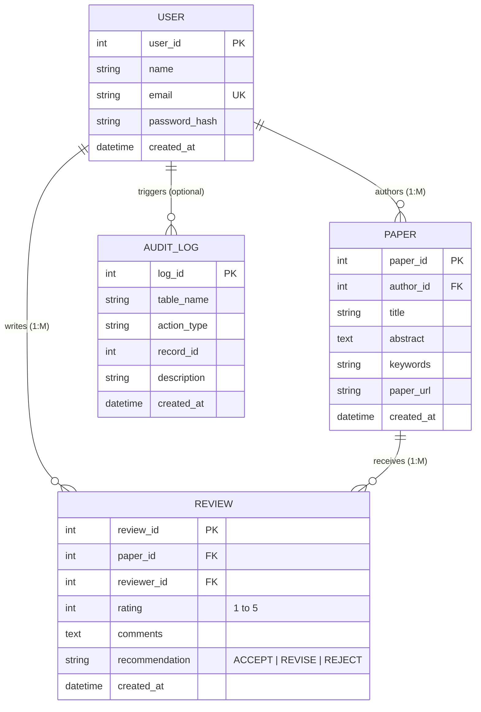

# PROE — System Requirements & Database Design Specification

**Project Name:** Peer Review Orchestration Engine (PROE)  
**Module:** Database Management Systems (DBMS)  
**Role:** Person 3 — Database Architect & DBMS Specialist  

---

## 1. Problem Statement

In academic, scientific, and technical research, peer review is the cornerstone of quality assurance and validation. Traditional manual review workflows, often conducted over disjointed email threads or spreadsheet trackers, suffer from significant inefficiencies:
- Lack of centralized tracking for submitted manuscripts.
- Vulnerability to data inconsistency, missing reviews, and untracked evaluations.
- Absence of structured auditing and role separation between paper authors and peer reviewers.
- Difficulty in aggregating quantitative metrics (such as average review scores and recommendation tallies).

**Peer Review Orchestration Engine (PROE)** resolves these challenges by providing a centralized, robust relational database backend paired with modern full-stack services. PROE facilitates academic paper submissions, automates reviewer assignment tracking, records qualitative and quantitative feedback, and enables author visibility into paper evaluations under rigorous relational integrity.

---

## 2. Functional Requirements

| Requirement ID | Module | Description |
|---|---|---|
| **FR-01** | **User Management** | The system must allow researchers and academics to register an account with a unique email address, full name, and securely hashed password. |
| **FR-02** | **Authentication & Session** | The system must authenticate registered users and maintain active sessions to differentiate authors from reviewers. |
| **FR-03** | **Paper Submission** | Authenticated users (Authors) must be able to submit research papers specifying title, abstract, keywords, and document reference URL. |
| **FR-04** | **Paper Discovery & Feed** | Users must be able to browse all submitted papers, view paper metadata, and filter or search papers by title or keywords. |
| **FR-05** | **Review Submission** | Registered users (acting as Peer Reviewers) must be able to submit an evaluation on a paper consisting of a numeric rating (1–5 scale), textual comments, and a recommendation decision (`ACCEPT`, `REVISE`, `REJECT`). |
| **FR-06** | **Author Review Access** | Authors must be able to view all submitted peer reviews for their own papers, including aggregate metrics (average score and recommendation summaries). |
| **FR-07** | **Author Self-Review Constraint** | A user should not be permitted to submit a review on their own authored paper (enforced at application and trigger/constraint level). |
| **FR-08** | **Audit Logging** | High-impact transactions (such as paper submissions, deletions, or review additions) must be automatically logged into an audit trail for accountability. |

---

## 3. Non-Functional Requirements

- **Data Integrity:** Strict enforcement of Primary Key, Foreign Key, Unique, and Check constraints in MySQL InnoDB engine.
- **ACID Compliance:** All multi-step database transactions (e.g., submitting a paper or review along with audit logs) must guarantee Atomicity, Consistency, Isolation, and Durability.
- **Normalization:** Relational schema must satisfy Third Normal Form (3NF) to eliminate insertion, update, and deletion anomalies.
- **Performance & Indexing:** Strategic B-Tree indexes on foreign keys, lookup fields, and sorting timestamps to ensure sub-millisecond query execution.
- **Extensibility:** Clean schema design that allows seamless integration with Java Servlets via JDBC and external NoSQL (MongoDB) activity tracking services.

---

## 4. Entity Identification & Attribute Specification

### 4.1 Entity: `User`
Represents any registered individual in the academic ecosystem. A user can act as an author, a reviewer, or both.

| Attribute Name | Data Type | Constraint | Description |
|---|---|---|---|
| `user_id` | `INT UNSIGNED` | `PRIMARY KEY`, `AUTO_INCREMENT` | Unique identifier for each user |
| `name` | `VARCHAR(100)` | `NOT NULL` | Full name of the researcher/user |
| `email` | `VARCHAR(150)` | `NOT NULL`, `UNIQUE` | Academic/personal email address (login credential) |
| `password_hash` | `VARCHAR(255)` | `NOT NULL` | Cryptographic hash of the user password |
| `created_at` | `DATETIME` | `NOT NULL`, `DEFAULT CURRENT_TIMESTAMP` | Account registration timestamp |

### 4.2 Entity: `Paper`
Represents a scientific or academic manuscript submitted to the platform.

| Attribute Name | Data Type | Constraint | Description |
|---|---|---|---|
| `paper_id` | `INT UNSIGNED` | `PRIMARY KEY`, `AUTO_INCREMENT` | Unique identifier for the paper |
| `author_id` | `INT UNSIGNED` | `NOT NULL`, `FOREIGN KEY (users.user_id)` | ID of the author who submitted the manuscript |
| `title` | `VARCHAR(255)` | `NOT NULL` | Full title of the research paper |
| `abstract` | `TEXT` | `NOT NULL` | Comprehensive summary of the research |
| `keywords` | `VARCHAR(255)` | `NOT NULL` | Comma-separated keywords for search and indexing |
| `paper_url` | `VARCHAR(500)` | `NOT NULL` | Storage URL or local file path to the manuscript document |
| `created_at` | `DATETIME` | `NOT NULL`, `DEFAULT CURRENT_TIMESTAMP` | Timestamp of submission |

### 4.3 Entity: `Review`
Represents an academic peer review submitted by an evaluator for a specific manuscript.

| Attribute Name | Data Type | Constraint | Description |
|---|---|---|---|
| `review_id` | `INT UNSIGNED` | `PRIMARY KEY`, `AUTO_INCREMENT` | Unique identifier for the review |
| `paper_id` | `INT UNSIGNED` | `NOT NULL`, `FOREIGN KEY (papers.paper_id)` | Reference to the paper being evaluated |
| `reviewer_id` | `INT UNSIGNED` | `NOT NULL`, `FOREIGN KEY (users.user_id)` | Reference to the user submitting the review |
| `rating` | `TINYINT UNSIGNED` | `NOT NULL`, `CHECK (rating BETWEEN 1 AND 5)` | Quantitative evaluation score (1: Poor to 5: Excellent) |
| `comments` | `TEXT` | `NOT NULL` | Detailed qualitative peer review commentary |
| `recommendation` | `ENUM('ACCEPT', 'REVISE', 'REJECT')` | `NOT NULL` | Peer reviewer's editorial decision |
| `created_at` | `DATETIME` | `NOT NULL`, `DEFAULT CURRENT_TIMESTAMP` | Timestamp of review submission |

### 4.4 Entity: `AuditLog` (DBMS Extension for Triggers)
Maintains an immutable historical record of database modifications triggered by system events.

| Attribute Name | Data Type | Constraint | Description |
|---|---|---|---|
| `log_id` | `INT UNSIGNED` | `PRIMARY KEY`, `AUTO_INCREMENT` | Unique identifier for the audit record |
| `table_name` | `VARCHAR(50)` | `NOT NULL` | Target table where operation occurred |
| `action_type` | `ENUM('INSERT', 'UPDATE', 'DELETE')` | `NOT NULL` | Type of DML action |
| `record_id` | `INT UNSIGNED` | `NOT NULL` | Primary key of the affected record |
| `description` | `VARCHAR(255)` | `NOT NULL` | Human-readable event description |
| `created_at` | `DATETIME` | `NOT NULL`, `DEFAULT CURRENT_TIMESTAMP` | Timestamp when the trigger fired |

---

## 5. Relationship, Cardinality & Participation Constraints

1. **User Authors Paper (`authors` relationship):**
   - **Cardinality:** $1 : M$ (One User can author zero, one, or many Papers).
   - **Participation:**
     - `Paper` $\rightarrow$ Total participation (every paper MUST have exactly one author).
     - `User` $\rightarrow$ Partial participation (a user may be a reviewer without having authored any paper).
   - **Referential Integrity:** `ON DELETE CASCADE` or `ON DELETE RESTRICT` (deleting an author handles paper cascade appropriately).

2. **Paper Receives Review (`evaluates` relationship):**
   - **Cardinality:** $1 : M$ (One Paper can receive zero, one, or multiple Reviews).
   - **Participation:**
     - `Review` $\rightarrow$ Total participation (a review cannot exist without an associated paper).
     - `Paper` $\rightarrow$ Partial participation (a newly submitted paper may initially have zero reviews).
   - **Referential Integrity:** `ON DELETE CASCADE` (if a paper is removed, its associated reviews are purged).

3. **User Writes Review (`evaluator` relationship):**
   - **Cardinality:** $1 : M$ (One User can submit zero, one, or multiple Reviews).
   - **Participation:**
     - `Review` $\rightarrow$ Total participation (every review must identify the reviewer who authored it).
     - `User` $\rightarrow$ Partial participation (a user may be an author without reviewing other papers).
   - **Business Constraint:** A user cannot review a paper where `reviewer_id = author_id`.

---

## 6. Entity-Relationship (ER) Diagram

Below is the Entity-Relationship structure represented using Mermaid notation:



---

## 7. Relational Schema Mapping (Logical Design)

Transforming the conceptual model into relational tables:

```text
USERS (
    user_id: INT [PK],
    name: VARCHAR(100) NOT NULL,
    email: VARCHAR(150) NOT NULL UNIQUE,
    password_hash: VARCHAR(255) NOT NULL,
    created_at: DATETIME NOT NULL
)

PAPERS (
    paper_id: INT [PK],
    author_id: INT [FK -> USERS.user_id] NOT NULL,
    title: VARCHAR(255) NOT NULL,
    abstract: TEXT NOT NULL,
    keywords: VARCHAR(255) NOT NULL,
    paper_url: VARCHAR(500) NOT NULL,
    created_at: DATETIME NOT NULL
)

REVIEWS (
    review_id: INT [PK],
    paper_id: INT [FK -> PAPERS.paper_id] NOT NULL,
    reviewer_id: INT [FK -> USERS.user_id] NOT NULL,
    rating: TINYINT NOT NULL [CHECK: 1..5],
    comments: TEXT NOT NULL,
    recommendation: ENUM('ACCEPT', 'REVISE', 'REJECT') NOT NULL,
    created_at: DATETIME NOT NULL
)

AUDIT_LOGS (
    log_id: INT [PK],
    table_name: VARCHAR(50) NOT NULL,
    action_type: ENUM('INSERT', 'UPDATE', 'DELETE') NOT NULL,
    record_id: INT NOT NULL,
    description: VARCHAR(255) NOT NULL,
    created_at: DATETIME NOT NULL
)
```

---

## 8. Summary of Day 1 Deliverable Status

- [x] Problem statement documented.
- [x] Functional requirements (FR-01 to FR-08) and non-functional requirements detailed.
- [x] Entities, attributes, data types, constraints, and keys established.
- [x] Cardinalities, participations, and referential actions defined.
- [x] Mermaid ER diagram created.
- [x] Relational schema mapping formalized.
